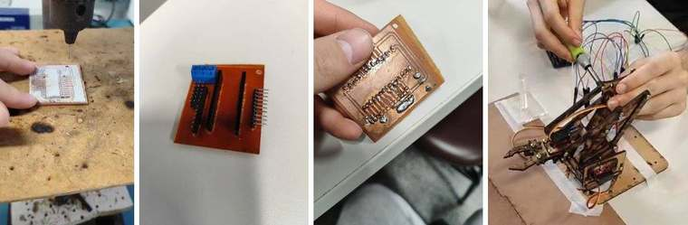

# Braço robótico que resolve a Torre de Hanói

Braço robótico com garra, controlado por Arduino, que resolve sozinho a Torre de Hanói com 2 discos. Projeto em grupo de 5 integrantes da disciplina **Princípios de Robótica** do curso de Engenharia de Computação da PUCPR.

▶️ **[Vídeo: o braço resolvendo o desafio](https://youtube.com/shorts/S9Qi0h_y-Ck)** · [Vídeo: montagem da estrutura](https://youtube.com/shorts/dhpvJZEUlQQ)



## Hardware

- **Arduino**, que executa o programa de controle
- **4 servomotores:** base (giro), ombro (sobe e desce), cotovelo (dobra o braço) e garra (abre e fecha)
- **Estrutura em MDF** cortado a laser, montada com parafusos a partir do kit da Eletrogate
- **Placa de circuito impresso feita pelo grupo** para organizar as ligações, simplificar a alimentação dos servos e reduzir ruídos

## Como o código funciona

O programa ([`braco_hanoi/braco_hanoi.ino`](braco_hanoi/braco_hanoi.ino)) executa as três jogadas da solução da Torre de Hanói com 2 discos:

```
disco pequeno: A → B
disco grande:  A → C
disco pequeno: B → C
```

Cada jogada é decomposta em movimentos do braço: posicionar acima da haste, descer, fechar a garra, subir, levar até a haste de destino, descer, abrir e subir.

Pontos principais da implementação:

- **Posições calibradas:** cada haste tem uma pose "alta" e duas poses "baixas", uma para o disco grande e outra para o pequeno. Cada pose combina os ângulos de base, ombro e cotovelo, guardados numa `struct Pose`.
- **Movimento suave:** os servos andam 1° por vez, com 15 ms entre passos, em vez de saltar direto para o ângulo final. O programa guarda a posição atual de cada servo para saber de onde partir.
- **Proteção contra colisões:** antes de um giro grande da base (mais de 30°), se o braço estiver baixo, ele sobe primeiro para uma posição segura.
- **Registro pela serial:** cada etapa é impressa no monitor serial (9600 baud), o que ajudou na calibração.

## Minha participação

Coordenei o grupo e, com um colega, conduzi a maior parte da montagem e dos testes. No código, trabalhei principalmente na calibração das posições e nos ajustes de movimento, até o braço completar o desafio de forma confiável.

## Fabricação da placa

1. Impressão a laser do circuito e transferência térmica para a placa de cobre
2. Corrosão do cobre exposto em percloreto de ferro
3. Furação
4. Inserção e solda dos componentes

## Como carregar no Arduino

1. Abra a pasta `braco_hanoi/` no Arduino IDE.
2. Ligue os servos nos pinos 10 (base), 8 (ombro), 9 (cotovelo) e 12 (garra).
3. Carregue o programa. Ele começa a resolver a torre 2 segundos depois de ligar.

Os ângulos das poses dependem da montagem física e precisam ser recalibrados em outro braço.

---

Frederico Assis Castellano · Engenharia de Computação, PUCPR
